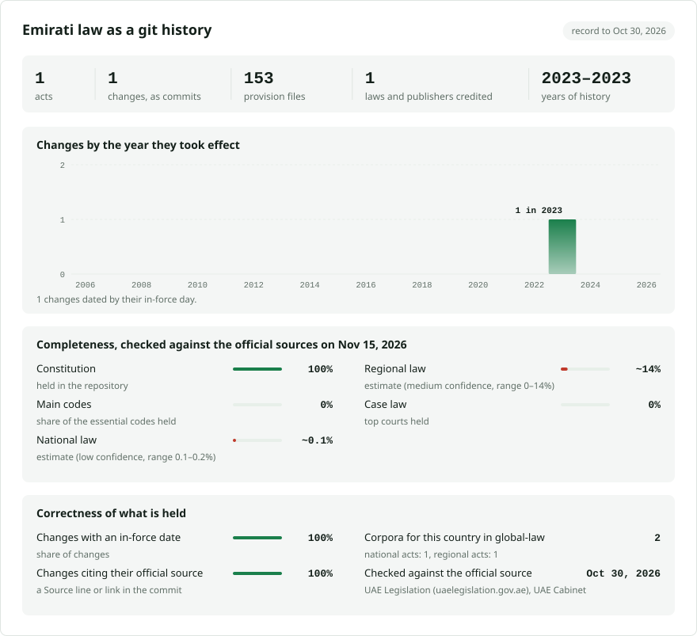

# United Arab Emirates: law history in git

[العربية](README.md) · **English**

<picture>
<source media="(prefers-color-scheme: dark)" srcset="data/effort-dark.svg">

</picture>

The law of the United Arab Emirates as a git history: one file per article, one commit per version on the day it took effect, and the law that made each change as the commit's author. `git blame` names the law behind every line; `git log` lists every change to an article; picking a date gives the text in force that day.

Part of [lexifina/global-law](https://github.com/lexifina/global-law), one git history for every country's law: this is the United Arab Emirates' national law, which global-law reads at `united-arab-emirates/national/acts/`.

**What is in it now:** the Constitution (152 articles, one version); 30 federal laws, 54 federal decree-laws and 128 Cabinet decisions from the federal legislation portal, each as the portal last showed it (85 also with the portal's English text); and 109 regulations, standards and other instruments of the Central Bank's rulebook. The main codes and case law are not here yet. [`STRUCTURE.md`](STRUCTURE.md) sets out the folders; [`REPRODUCE.md`](REPRODUCE.md) says how the history was built.

The Constitution is in `الدستور/`, one file per article (`الدستور/art-030.md` is Article 30, on freedom of opinion and expression); a law is one file, `<folder>/<year>/<number>.md`.

The text is in Arabic, which is authoritative, as the portal publishes it. Where the portal publishes an English text for a law, it is beside it as `<number>.en.md` (an official translation; the Arabic prevails).

## Questions as git commands

| Question | Command |
| --- | --- |
| Every change to Article 30 of the Constitution | `git log -p --word-diff -- constitution/art-030.md` |
| Which law wrote each line of Article 30? | `git blame constitution/art-030.md` |
| Every version of the Constitution, with the day each took effect | `git log --format="%h %(trailers:key=In-force,valueonly,separator=) %an" -- constitution ":^constitution/README.md"` |
| Article 30 as in force on 1 January 2026 | `python tools/on.py 2026-01-01 constitution art-030` |

**Outside git**, we also host this record publicly, for free:

- **[Ask Claude about Emirati law](https://global-law.lexifina.com/v1/try_claude?country=united-arab-emirates)**: opens Claude with a first question ready.
- **[Ask ChatGPT](https://global-law.lexifina.com/v1/try_chatgpt?country=united-arab-emirates)**: the same question in ChatGPT.
- **[Search Emirati law on our site](https://lexifina.com/law?country=united-arab-emirates&q=%D8%AD%D8%B1%D9%8A%D8%A9+%D8%A7%D9%84%D8%B1%D8%A3%D9%8A)**: a search for "حرية الرأي" (freedom of opinion), with each provision's text and its versions, no account needed.
- **[Developer REST API](https://global-law.lexifina.com/v1/search_law?query=%D8%AD%D8%B1%D9%8A%D8%A9+%D8%A7%D9%84%D8%B1%D8%A3%D9%8A&jurisdiction=united-arab-emirates)**: the same search as JSON, with no key. See the [documentation here](https://lexifina.com/api/global-law).

Both assistants read the record through the free Global law connector (MCP, `https://global-law.lexifina.com/mcp`); the first time, the chat gives you the link that adds it. Ask in Arabic or in English.

**Host it yourself easily.** All it takes is git and Python, and the tools run on your machine:

```sh
git clone --depth 1 https://github.com/lexifina/global-law && cd global-law
python3 tools/countries.py add united-arab-emirates/national/acts
python3 tools/law.py show 2026-01-01 united-arab-emirates/national/acts/constitution/art-030.md
```

Opened in Claude Code, Cursor, VS Code or Codex, the clone also starts a local MCP server with the same tools ([MCP.md](https://github.com/lexifina/global-law/blob/main/MCP.md)).

## Dates

Each commit is dated at noon, Asia/Dubai, on the day the version took effect, and carries it in its `In-force:` trailer:

- The one version is dated 29 March 2023, the day the portal gives for its last update of the text, not a day taken from an amending law; earlier days show nothing.
- Laws added later are dated by their own in-force clause or, without one, one month after their publication in the Official Gazette (Constitution, art. 111).

The version is the "oldest version available", credited to the publisher, UAE Legislation (uaelegislation.gov.ae), UAE Cabinet, with an address that cannot exist (`publisher@uaelegislation.invalid`), not to a law. The committer is Lexifina.

## How it is checked

- `tools/check_repo.py` reads every version back from git on the day it took effect and on the day before and compares it with the corpus; it also requires every commit's trailers to parse, no merge commits on `main`, commit dates that never go backwards and nothing dated in the future. `REPRODUCE.md` records that it was not run for this build.
- `tools/build.py` gives the same commit hashes from the same corpus; no second build has been compared yet.
- The text is not yet compared with a second official copy, such as the portal's Arabic PDF.
- [vulnerabilities/](vulnerabilities/README.en.md): possible drafting mistakes in this law, found by global-law's detectors and checked by hand. Not run yet.

## What it does not show

- **The Constitution's history.** It was issued in 1971 and has been amended since; its earlier wordings, and the amendments that made each change, are not yet commits.
- **Headings and the preamble.** Part and chapter headings are not files, and the preamble, which the portal publishes separately, is not included.
- **Other legislation.** Federal laws and decree-laws, Cabinet resolutions, treaties and case law are not here.

## Sources

| Source | Kind | Past versions | Notes |
| --- | --- | --- | --- |
| [UAE Legislation](https://uaelegislation.gov.ae) (UAE Cabinet) | Federal government legislation portal | only the current text is used | The Arabic page of the Constitution (legislation 1000), read from an [Internet Archive copy of 29 May 2025](https://web.archive.org/web/20250529114023/https://uaelegislation.gov.ae/ar/legislations/1000/) |

## Licence

See [`LICENSE`](LICENSE). Federal Decree-Law No. 38 of 2021 on Copyright and Neighbouring Rights, Article 3(2), removes protection from official documents such as the texts of laws, regulations and resolutions; the text is published on that basis. Lexifina's history, commit messages, tables and tools are CC0 1.0.

No AI model wrote, translated or corrected legal text, and none runs when the history is built; the scripts were written by an AI model (see [`REPRODUCE.md`](REPRODUCE.md)).

## Visualisations

- [visualisations/](visualisations/README.en.md): charts drawn from this repository. Not drawn yet.

## More

From [lexifina/global-law](https://github.com/lexifina/global-law):

- [FEATURES.md](https://github.com/lexifina/global-law/blob/main/FEATURES.md): every feature, and what every corpus must support (`git blame`, `law.py`, the MCP tools)
- [FAQ.md](https://github.com/lexifina/global-law/blob/main/FAQ.md): questions and answers · [CONTRIBUTING.md](https://github.com/lexifina/global-law/blob/main/CONTRIBUTING.md): proposing changes · [MCP.md](https://github.com/lexifina/global-law/blob/main/MCP.md): the MCP server · [REPRODUCE.md](https://github.com/lexifina/global-law/blob/main/REPRODUCE.md): how it was built · [CHANGELOG.md](https://github.com/lexifina/global-law/blob/main/CHANGELOG.md)
- [FRESHNESS.md](https://github.com/lexifina/global-law/blob/main/FRESHNESS.md): how current each corpus is · [Monitoring](https://github.com/lexifina/global-law/tree/main/monitoring): whether updates are running · [WATCHING.md](https://github.com/lexifina/global-law/blob/main/WATCHING.md): how each official source is watched for changes
- [performance/](https://github.com/lexifina/global-law/tree/main/performance): how fast the tools are, measured
- [visualisations/](https://github.com/lexifina/global-law/tree/main/visualisations): charts and bridges across the world's law
- [Vulnerabilities](https://github.com/lexifina/global-law/tree/main/vulnerabilities): mistakes in legislation as published
