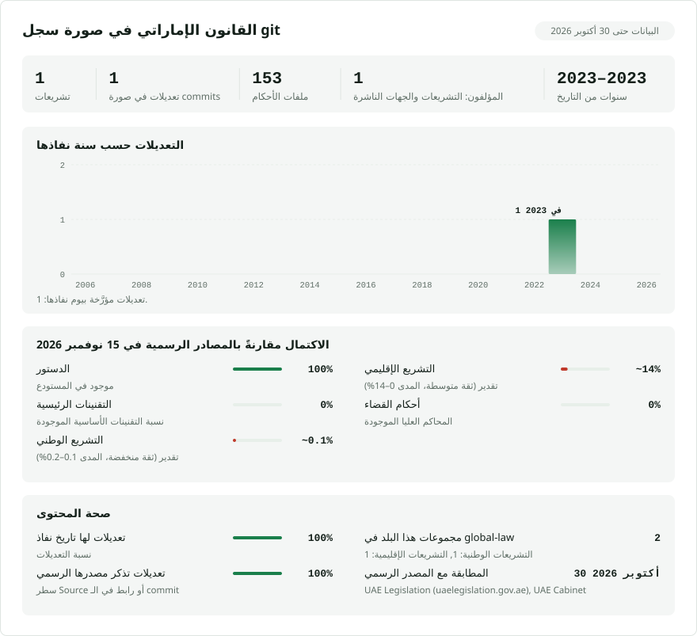

# الإمارات العربية المتحدة: تاريخ القانون في git

**العربية** · [English](README.en.md)

<picture>
<source media="(prefers-color-scheme: dark)" srcset="data/ar/effort-dark.svg">

</picture>

قانون دولة الإمارات العربية المتحدة في صورة سجل git: ملف واحد لكل مادة، وcommit واحد لكل نسخة في يوم نفاذها، والقانون الذي أجرى كل تعديل هو مؤلف الـ commit. يذكر `git blame` القانون الذي يقف وراء كل سطر؛ ويسرد `git log` كل تعديل طرأ على مادة ما؛ واختيار تاريخ ما يعطي النص النافذ في ذلك اليوم.

جزء من [lexifina/global-law](https://github.com/lexifina/global-law)، وهو سجل git واحد لقوانين جميع الدول: هذا هو القانون الوطني لدولة الإمارات العربية المتحدة، الذي يقرؤه global-law في `united-arab-emirates/national/acts/`.

**ما يحتويه الآن:** الدستور (152 مادة، في نسخة واحدة)؛ و30 قانونًا اتحاديًا، و54 مرسومًا بقانون اتحادي، و128 قرارًا لمجلس الوزراء من بوابة التشريعات الاتحادية، كلٌّ منها كما عرضته البوابة آخر مرة (85 منها مع نصها الإنجليزي في البوابة)؛ و109 أنظمة ومعايير وأدوات أخرى من دليل أنظمة المصرف المركزي. ولا توجد هنا بعدُ القوانين الأساسية الكبرى ولا الأحكام القضائية. يبيّن [`STRUCTURE.md`](STRUCTURE.md) ترتيب المجلدات؛ ويبيّن [`REPRODUCE.md`](REPRODUCE.md) كيف بُني السجل.

الدستور في `الدستور/`، ملف واحد لكل مادة (`الدستور/art-030.md` هي المادة 30، بشأن حرية الرأي والتعبير)؛ وكل قانون ملف واحد، `<المجلد>/<السنة>/<الرقم>.md`.

النص باللغة العربية، وهو النص المعتمد، كما تنشره البوابة. وحيث تنشر البوابة نصًا إنجليزيًا لقانون، فهو بجانبه في `<الرقم>.en.md` (ترجمة رسمية؛ والنص العربي هو المعتمد).

## الأسئلة بصيغة أوامر git

| السؤال | الأمر |
| --- | --- |
| كل تعديل طرأ على المادة 30 من الدستور | `git log -p --word-diff -- constitution/art-030.md` |
| أي قانون كتب كل سطر من المادة 30؟ | `git blame constitution/art-030.md` |
| كل نسخ الدستور، مع يوم نفاذ كل منها | `git log --format="%h %(trailers:key=In-force,valueonly,separator=) %an" -- constitution ":^constitution/README.md"` |
| المادة 30 كما كانت نافذة في 1 يناير 2026 | `python tools/on.py 2026-01-01 constitution art-030` |

**خارج git**، نستضيف هذا السجل أيضًا للعموم مجانًا:

- **[اسأل Claude عن القانون الإماراتي](https://global-law.lexifina.com/v1/try_claude?country=united-arab-emirates)**: يفتح Claude مع سؤال أول جاهز.
- **[اسأل ChatGPT](https://global-law.lexifina.com/v1/try_chatgpt?country=united-arab-emirates)**: السؤال نفسه في ChatGPT.
- **[ابحث في القانون الإماراتي على موقعنا](https://lexifina.com/law?country=united-arab-emirates&q=%D8%AD%D8%B1%D9%8A%D8%A9+%D8%A7%D9%84%D8%B1%D8%A3%D9%8A)**: بحث عن "حرية الرأي"، مع نص كل حكم ونسخه، دون الحاجة إلى حساب.
- **[واجهة REST API للمطورين](https://global-law.lexifina.com/v1/search_law?query=%D8%AD%D8%B1%D9%8A%D8%A9+%D8%A7%D9%84%D8%B1%D8%A3%D9%8A&jurisdiction=united-arab-emirates)**: البحث نفسه بصيغة JSON، دون مفتاح. انظر [التوثيق هنا](https://lexifina.com/api/global-law).

يقرأ كلا المساعدَين السجلَّ عبر موصل Global law المجاني (MCP، `https://global-law.lexifina.com/mcp`)؛ وفي المرة الأولى تعطيك المحادثة الرابط الذي يضيفه. اسأل بالعربية أو بالإنجليزية.

**استضِفه بنفسك بسهولة.** كل ما يلزم هو git وPython، والأدوات تعمل على جهازك:

```sh
git clone --depth 1 https://github.com/lexifina/global-law && cd global-law
python3 tools/countries.py add united-arab-emirates/national/acts
python3 tools/law.py show 2026-01-01 united-arab-emirates/national/acts/constitution/art-030.md
```

عند فتح النسخة المستنسخة في Claude Code أو Cursor أو VS Code أو Codex، تشغّل أيضًا خادم MCP محليًا بالأدوات نفسها ([MCP.md](https://github.com/lexifina/global-law/blob/main/MCP.md)).

## التواريخ

يحمل كل commit تاريخ الظهر، بتوقيت Asia/Dubai، من يوم نفاذ النسخة، ويذكر هذا التاريخ في حقله الختامي (trailer) `In-force:`:

- النسخة الوحيدة مؤرَّخة في 29 مارس 2023، وهو اليوم الذي تذكره البوابة لآخر تحديث للنص، لا يوم مأخوذ من قانون معدِّل؛ والأيام السابقة لا تُظهر شيئًا.
- القوانين التي تُضاف لاحقًا تؤرَّخ بنص النفاذ الوارد فيها أو، إن لم يوجد، بعد شهر من نشرها في الجريدة الرسمية (الدستور، المادة 111).

النسخة هي "oldest version available" (أقدم نسخة متاحة)، منسوبة إلى الناشر، التشريعات الإماراتية (uaelegislation.gov.ae)، مجلس الوزراء، بعنوان لا يمكن أن يوجد (`publisher@uaelegislation.invalid`)، لا إلى قانون. وصاحب الـ commit (committer) هو Lexifina.

## طريقة التحقق

- يعيد `tools/check_repo.py` قراءة كل نسخة من git في يوم نفاذها وفي اليوم السابق له ويقارنها بالمجموعة؛ ويشترط أيضًا أن تكون الحقول الختامية لكل commit قابلة للتحليل، وألا توجد commits دمج (merge) على `main`، وألا ترجع تواريخ الـ commits إلى الوراء أبدًا، وألا يكون شيء مؤرَّخًا في المستقبل. ويسجّل `REPRODUCE.md` أنه لم يُشغَّل لهذا البناء.
- يعطي `tools/build.py` قيم تجزئة الـ commits نفسها من المجموعة نفسها؛ ولم تُقارَن بعدُ أي عملية بناء ثانية.
- لم يُقارَن النص بعدُ بنسخة رسمية ثانية، مثل ملف PDF العربي في البوابة.
- [vulnerabilities/](vulnerabilities/): أخطاء صياغة محتملة في هذا القانون، تكشفها أدوات global-law وتُراجَع يدويًا. لم تُشغَّل بعد.

## ما لا يتضمنه

- **تاريخ الدستور.** صدر في عام 1971 وعُدِّل منذ ذلك الحين؛ وصيغه السابقة، والتعديلات التي أجرت كل تغيير، ليست commits بعد.
- **العناوين والديباجة.** عناوين الأبواب والفصول ليست ملفات، والديباجة، التي تنشرها البوابة منفصلة، غير مدرجة.
- **التشريعات الأخرى.** القوانين الاتحادية والمراسيم بقوانين اتحادية وقرارات مجلس الوزراء والمعاهدات وأحكام القضاء ليست هنا.

## المصادر

| المصدر | النوع | النسخ السابقة | ملاحظات |
| --- | --- | --- | --- |
| [التشريعات الإماراتية](https://uaelegislation.gov.ae) (مجلس الوزراء) | بوابة التشريعات للحكومة الاتحادية | لا يُستخدم إلا النص الحالي | الصفحة العربية للدستور (التشريع 1000)، مقروءة من [نسخة Internet Archive بتاريخ 29 مايو 2025](https://web.archive.org/web/20250529114023/https://uaelegislation.gov.ae/ar/legislations/1000/) |

## الترخيص

انظر [`LICENSE`](LICENSE). يرفع المرسوم بقانون اتحادي رقم (38) لسنة 2021 في شأن حقوق المؤلف والحقوق المجاورة، في البند (2) من المادة (3)، الحماية عن الوثائق الرسمية مثل نصوص القوانين واللوائح والقرارات؛ ويُنشر النص على هذا الأساس. أما السجل الذي أعدّته Lexifina ورسائل الـ commits والجداول والأدوات فخاضعة لـ CC0 1.0.

لم يكتب أي نموذج ذكاء اصطناعي نصًا قانونيًا ولم يترجمه ولم يصحّحه، ولا يعمل أي نموذج عند بناء السجل؛ أما البرامج النصية فقد كتبها نموذج ذكاء اصطناعي (انظر [`REPRODUCE.md`](REPRODUCE.md)).

هذا النص ترجمة للنسخة الإنجليزية ([README.en.md](README.en.md))؛ وعند الاختلاف تسود النسخة الإنجليزية.

## الرسوم البيانية

- [visualisations/](visualisations/): رسوم بيانية مستخرجة من هذا المستودع. لم تُرسم بعد.

## المزيد

من مستودع [lexifina/global-law](https://github.com/lexifina/global-law) (صفحات باللغة الإنجليزية):

- [FEATURES.md](https://github.com/lexifina/global-law/blob/main/FEATURES.md): جميع الميزات، وما يجب أن تدعمه كل مجموعة (`git blame`، `law.py`، أدوات MCP)
- [FAQ.md](https://github.com/lexifina/global-law/blob/main/FAQ.md): أسئلة وأجوبة · [CONTRIBUTING.md](https://github.com/lexifina/global-law/blob/main/CONTRIBUTING.md): اقتراح تغييرات · [MCP.md](https://github.com/lexifina/global-law/blob/main/MCP.md): خادم MCP · [REPRODUCE.md](https://github.com/lexifina/global-law/blob/main/REPRODUCE.md): طريقة البناء · [CHANGELOG.md](https://github.com/lexifina/global-law/blob/main/CHANGELOG.md)
- [FRESHNESS.md](https://github.com/lexifina/global-law/blob/main/FRESHNESS.md): مدى حداثة كل مجموعة · [المراقبة](https://github.com/lexifina/global-law/tree/main/monitoring): هل تعمل التحديثات · [WATCHING.md](https://github.com/lexifina/global-law/blob/main/WATCHING.md): كيف يُراقَب كل مصدر رسمي لرصد التغييرات
- [performance/](https://github.com/lexifina/global-law/tree/main/performance): سرعة الأدوات كما قيست
- [visualisations/](https://github.com/lexifina/global-law/tree/main/visualisations): رسوم بيانية وروابط عبر قوانين العالم
- [الثغرات](https://github.com/lexifina/global-law/tree/main/vulnerabilities): أخطاء في التشريعات كما نُشرت
